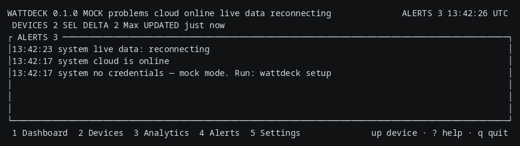
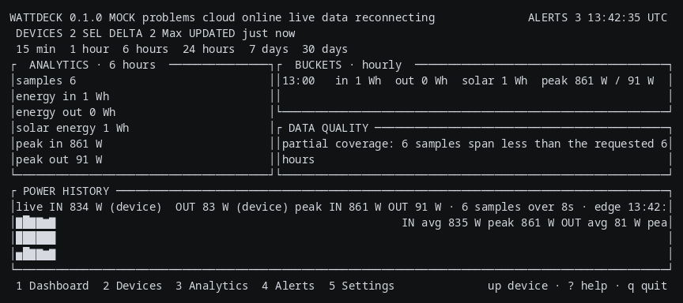

# wattdeck

Terminal dashboard for EcoFlow power stations — live telemetry, history, alerts.
One Rust binary: no web app, no Electron, no daemon, no cloud.

[](https://github.com/olexanderboychuk/wattdeck/actions/workflows/ci.yml)
[](#status)
[](https://github.com/olexanderboychuk/wattdeck/releases)
[](LICENSE)


**wattdeck** is the app; EcoFlow is the vendor of the devices it monitors. The
header carries the app name only.


## Contents

- [Install](#install)
- [What you see](#what-you-see)
- [How it gets the data](#how-it-gets-the-data)
- [Keys and safety](#keys-and-safety)
- [Sharing it](#sharing-it)
- [Configuration](#configuration)
- [Controls, and the safety rules around them](#controls-and-the-safety-rules-around-them)
- [Privacy](#privacy)
- [FAQ](#faq)
- [Troubleshooting](#troubleshooting)
- [Keyboard](#keyboard)
- [CLI surface](#cli-surface)
- [Documentation](#documentation)
- [Status](#status)
- [License](#license)

## Install

```
macOS / Linux:  curl -sSL https://raw.githubusercontent.com/olexanderboychuk/wattdeck/main/install.sh | sh
Windows:        irm https://raw.githubusercontent.com/olexanderboychuk/wattdeck/main/install.ps1 | iex
```

The installer detects the OS and CPU, picks the matching release asset, verifies
its SHA256 against `SHA256SUMS.txt` **before** extracting anything, installs the
binary into `~/.local/bin` (macOS/Linux) or
`%LOCALAPPDATA%\wattdeck\bin` (Windows), prints the `PATH` line to add if the
install directory is not on `PATH`, and prints the version it installed. No
sudo, no root, no third-party release action, no silent guesses. An OS/CPU
combination outside the built targets is refused by name.

Built targets: `x86_64-unknown-linux-gnu` (Linux x86_64),
`aarch64-apple-darwin` (macOS Apple silicon), `x86_64-pc-windows-msvc`
(Windows x86_64). No ARM Windows, no ARM Linux, no Intel Mac: those targets are
not built. The Linux binary is built on GitHub's runner, so it needs that
runner's glibc or newer.

Three environment variables are test seams, documented as test-only:
`WATTDECK_INSTALL_DIR` (where to install), `WATTDECK_TAG` (which tag to install)
and `WATTDECK_RELEASE_DIR` (a local directory of release assets, so the install
can be verified without a network). `tests/install_sh.sh` and
`tests/install_ps1.sh` use them.

From source, or via cargo:

```
cargo install --git https://github.com/olexanderboychuk/wattdeck   # verified from the pushed main, 2026-11-12
git clone https://github.com/olexanderboychuk/wattdeck && cd wattdeck
make           # full verify: build, tests, fmt --check, clippy
make install   # into ~/.local/bin (override with PREFIX=…)
```

Requirements: Rust. `rust-toolchain.toml` pins 1.89.0, and that number is the
floor the dependencies set, not a preference: rusqlite 0.41.1 and uuid 1.29.2
declare `rust-version = "1.89.0"`, so cargo's own MSRV check refuses 1.88.0 (CI
printed `rusqlite@0.41.1 requires rustc 1.89.0` on 2026-11-11, which is why the
pin moved). All three CI runners build on the pinned 1.89.0 — each job prints
`rustc 1.89.0 (29483883e 2025-08-04)` — and newer toolchains build it too:
development is on 1.99.0. On Linux you need a C toolchain for the bundled SQLite
build. GNU Make is convenient, not required. `make help` lists the targets:
`make run` (mock), `make run-live` (real devices), `make run-debug` (mock +
masked log file), `make test-install`, `make screenshots`.

Then run the wizard once:

```
wattdeck setup
```

It asks for your Access Key and Secret Key (echo off), stores them in the OS
keyring, reads them back, and prints the devices the keys can see, with masked
serials. On a machine with no secret service it asks before writing the
plaintext file, and says what protection that file has on your platform. It
needs a terminal; piped stdin is refused with the env-var path named. Keys come
from the [EcoFlow developer portal](https://open.ecoflow.com): the key is issued
for your account, and the devices it can see are the devices linked to that
account in the EcoFlow app.

`wattdeck --init` writes the starter `config.toml` for a scripted install, plus
the credential template **only** when no secret service is present.

## What you see

**Dashboard.** Five regions: a two-line header (name, version, `MOCK` badge, each
transport's state in plain words and colour, device count, the selected device,
freshness, active alerts and the clock), a device strip, the device overview beside
the power-flow panel, the power-history chart, and BMS diagnostics beside the
connection panel. The overview carries charge percentage, the gauge, remaining and
capacity in kWh, health, cycles, temperature and the runtime. The runtime row says
what the number means: `full in 58m` while charging, `runs 1h 12m` while
discharging, `idle` at rest, `full` at the charge limit, and `state unknown` when
nothing has been reported. Every number is marked with where it came from —
`(device)` for a value the device reported, `(calc)` for what the app computed,
`--` for a channel the device supports but did not send, `n/a` for a channel this
model does not have. The layout is responsive: panels keep content minimums, spare
rows go to the history chart, and a terminal narrower than 72 columns stacks the
panels.

**Devices.** One row per device: its state as the app can defend it (`online`,
`connecting`, `stale`, `offline`, `not supported`, `sign-in failed`), charge
percentage, input and output power, the masked serial, and the transport the data
came on. `enter` opens the device screen, which carries the state, when the live
feed and the cloud last answered, how many properties the device has sent, its
productType, the capabilities verified for that model, the cloud's refusal text if
it refused, the controls the model supports, and the raw property inspector.



**Alerts.** Low and critical battery, high temperature, high output above the
configured limit, disconnects, API refusals, storage problems, command replies,
and the credential-state lines (which key backend is in use, what a plaintext
file means on this platform, and the wizard's name when no credentials are
registered). `4` opens the list.



**Analytics.** Power and energy bucketed per minute, 5 minutes, hour, day and
week, with the tariff cost line, plus the data-quality panel that says what is
missing: fewer than two samples in a range, partial coverage, gaps longer than
15 min not integrated.

## How it gets the data

Live telemetry comes from two transports that run at once and have independent
connection states: the MQTT broker (the device pushes) and the developer REST
API (backfill and fallback). The app uses the EU hosts it has verified:
`api-e.ecoflow.com` for REST and `mqtt-e.ecoflow.com:8883` (mqtts) for MQTT.
Signing sorts the query parameters before the auth fields; the HMAC-SHA256
signature, the six-digit nonce, and the sorted-parameter rule are verified
against the developer docs and a live device.

Every reported property is kept. The raw key/value map is on screen in the
inspector, so a value the app does not know how to display is never hidden.
The normalizer scales BMS arrays to volts and amps and maps the device's
property keys into one state; unknown keys pass through. A RIVER mini on the
same account is offline, and its property map returns `code 1006` — the app
shows it as offline and never displays invented values for it. History lives in a
local SQLite database: one sample per device every 5 s (configurable). A report with
the same numbers as the last one is not stored twice, and the last identical sample
is stored again every 10 minutes, so history shows that a station at rest is still
answering. The ranges are 15 m, 1 h, 6 h and 24 h; the chart draws as soon as there
is one sample and never fills a gap with an estimate. A restart loads the rows back
from the database. 90-day retention. Mock runs never write history.

## Keys and safety

`ECOFLOW_ACCESS_KEY` and `ECOFLOW_SECRET_KEY` take precedence over the keyring
and the file; the store order is env → keyring → file. The app warns (without
printing the contents) if the credential file is world-readable, reports a
plaintext file that the keyring backend does not read, and never touches a
credential file it did not write. Keys are never in `config.toml`, never
printed, and the log file masks registered secrets. The keyring service name is
`wattdeck`.

Controls are **off by default**. `--read-only` forces them off for the run,
whatever the config says. `--live` is opt-in because it contacts the API;
`--live` without credentials is an error, not a silent fallback. Running with no
flags uses the mock provider with the badge and one notice on the Alerts screen
naming `wattdeck setup` as the way in. `--live` and `--mock` cannot be combined.

**Rotate the keys if they may have leaked** — the developer portal issues them
for your account, so a key that has been pasted into a chat, a transcript, a CI
log, or a shared config is a key you should replace. The app never prints the
keys, and the log file masks them, but the app cannot undo a key that left the
machine.

## Sharing it

Try it first: on a fresh machine `wattdeck` runs in mock mode with the `MOCK`
badge, no account, no network.

**Keys are account-scoped.** Your keys see the devices linked to your EcoFlow
account, and handing someone your keys gives them your whole account — reads and
commands. `[verified]`

A shared viewer: give the app plus your keys and run `wattdeck --live --read-only`
— commands disabled for the run. `wattdeck devices` prints exactly what the keys
can see, masked.

Per-person accounts (the honest long-term answer, **not checked**): each person
registers their own developer app and gets their own keys. The open question is
whether a device shared to a second EcoFlow account is visible through that
account's API keys. The check: register a second app with a second account, run
`wattdeck devices` with those keys, and record the answer. Until that is done,
this is a question, not a feature.

## Configuration

`wattdeck --config PATH` points at a config file elsewhere. Every key and its
default is in [docs/CONFIGURATION.md](docs/CONFIGURATION.md). The app's own
locations, per platform:

- Linux: `$XDG_CONFIG_HOME/wattdeck` else `~/.config/wattdeck`; data in
  `$XDG_DATA_HOME/wattdeck` else `~/.local/share/wattdeck`
- macOS: `~/Library/Application Support/wattdeck`
- Windows: `%APPDATA%\wattdeck` for config, `%LOCALAPPDATA%\wattdeck` for data

The locations come from `directories::BaseDirs`, which asks the OS, not a
`$HOME` that does not exist on Windows. A machine with no per-user profile gets
a message that names the missing profile, not a false claim about `HOME`.

## Controls, and the safety rules around them

Controls are **off by default**. Turning them on is a config decision, and the
app then requires three things before a command goes out: a control picked
(`c` / `shift+c`), a value (`left` / `right`), and a confirmation (`enter` / `y`;
`n` or `esc` cancels and sends nothing).

- The app sends **only** commands that have been verified — the DELTA 2 family
  list in `src/controls/mod.rs`. A family with no verified command offers
  nothing, so a command is never invented and sent to a device.
- A command carries the **full parameter set** the verified command carries.
  Parameters the device has are echoed from the value it reported, so a command
  changes the one setting you picked and leaves every other setting where the
  device has it. A partial parameter set was published by this app on 2026-11-10:
  the broker accepted it, the device half-applied it (`inv.SlowChgWatts` moved
  to a value that was never sent) and never answered. The full set is answered
  with `code 0`.
- A device that is offline, or that has reported nothing, is refused before
  publishing: nothing is sent.
- `--read-only` forces controls off, whatever the config says.

The command's result comes back on `set_reply` and is shown as an alert naming
the control. `0` means accepted by the device; `-1` not owned, `-2` offline,
`-3` out of range, `-4` the broker refused the publish, `-5` the device has
reported no settings.

## Privacy

Serials are masked in the UI, in logs and in the JSON export by default
(`R3************44`); `i` switches to the raw serial. History stores masked
serials, so the database contains no plain serial: verified by reading the
rows back. Credentials are never printed by the app, `credentials.toml` is
created with the platform's protection (mode 600 on unix, inside the user
profile on Windows), and the log file has secrets masked.

## FAQ

**Why is there a mock mode?** So the app can be tried with no account and no
network, and so a screenshot, a demo, a test and a development run can never be
mistaken for live readings: mock screens carry the `MOCK` badge and mock runs
write no history.

**Is it safe to run?** It reads. Controls are off by default, `--read-only`
forces them off, and a command needs pick + value + confirmation. The first run
on a fresh machine contacts nothing.

**What goes into the history file?** Timestamped samples with the masked serial,
the model, SOC, power in and out, temperatures, and the source label. No plain
serial, no keys. `[verified]` — checked by reading the rows back.

**Does it work offline?** Mock mode does. Live mode needs the network, and
refuses with a message naming the way in when there are no credentials.

**Rate limits?** The installer makes one unauthenticated GitHub API request per
install to find the latest tag; GitHub's documented limit is 60 requests per
hour per IP, and `WATTDECK_TAG` + `WATTDECK_RELEASE_DIR` let you skip that
request entirely. The app's request rate is the configured refresh interval and
the MQTT subscription — the app does not poll faster than you set.

**Why are the serials masked?** The serial identifies your device and, with the
API keys, your account. Masked by default everywhere, switchable with `i`.

**How much does it use?** Peak RSS measured on this machine: mock run 13.8 MB,
live run 19.8 MB. The UI never blocks on the network or disk: the providers and
the storage writer run on their own threads with bounded channels, and the screen
renders when state changes.

## Troubleshooting

- **The keyring read fails on a desktop with a locked wallet** (KWallet, GNOME
  Keyring): the app falls back and reports the backend it used. The desktop
  behaviour is **labelled unverified** — the `keyring` crate supports the
  Secret Service, the macOS Keychain and Windows Credential Manager by design,
  and only the Secret Service has run wattdeck.
- **No secret service on this machine**: `wattdeck setup` asks before writing
  the plaintext file, and names the protection that file has on your platform.
  `ECOFLOW_ACCESS_KEY` / `ECOFLOW_SECRET_KEY` are the scripted path.
- **The Linux binary needs the build machine's glibc or newer** — built on
  GitHub's `ubuntu-latest` runner. The exact floor is **labelled unverified**;
  the source build has no such constraint.
- **Windows console**: the terminal behaviour on Windows is **labelled
  unverified** (no Windows machine has run wattdeck); the install script's
  self-test and the CI Windows job check the installer, not the console.
- **`no latest release` from the installer**: GitHub's rate limit, and the
  escape hatch is `WATTDECK_TAG` + `WATTDECK_RELEASE_DIR`.

## Keyboard

`1` dashboard · `2` devices · `3` analytics · `4` alerts · `5` settings · `?` help.
`tab` / `shift+tab` cycle screens, `l` / `h` move between panels, `up` / `down`
between devices, `left` / `right` between panels and control values, `pgup` /
`pgdn` / `home` / `end` scroll lists. `r` requests a refresh, `f` changes the
frame rate, `u` switches °C/°F, `i` switches serial display, `s` switches the mock
scenario, `q` quits. [Full key table](docs/KEYBOARD_SHORTCUTS.md), and keys are
configurable in `[keys]` in `config.toml`.

## CLI surface

```
wattdeck --config PATH --debug --mock --live --device SERIAL --read-only --scenario NAME --init
wattdeck setup      # the wizard
wattdeck devices    # device list
wattdeck status     # one-shot summary
wattdeck export --format json
```

## Documentation

- [Architecture](docs/ARCHITECTURE.md) — how the pieces fit, and why the UI never blocks
- [API integration](docs/API_INTEGRATION.md) — signing, endpoints, MQTT topics, what is verified
- [Device support](docs/DEVICE_SUPPORT.md) — families, product types, property keys, which commands are verified
- [Configuration](docs/CONFIGURATION.md) — every config key and its default
- [Keyboard shortcuts](docs/KEYBOARD_SHORTCUTS.md)
- [Security policy](SECURITY.md) — what is sensitive, where credentials live, what to do if keys leaked
- [Development](docs/DEVELOPMENT.md) — build, test, mock mode, the live probes

## Status

Working and verified against a live DELTA 2 Max (productType 81): telemetry,
history, analytics, alerts, JSON export, and the set round trip. The RIVER mini
on the same account is offline and the API refuses its property map
(`code 1006`), so the app shows it as offline and never displays invented
values for it. Controls for families other than DELTA 2 are not offered,
because no verified command list exists for them in this project.

CI on `ubuntu-latest`, `macos-latest` and `windows-latest`, on the pinned 1.89.0:
fmt --check, clippy `-D warnings`, 235 library tests, the CLI tests, the platform
tests, the release build for each target, `install.sh` and `install.ps1` tests,
`install.ps1 -SelfTest` on the Windows runner, `render_frame`, and shellcheck on
the shell files. That run is the evidence for the build/test claims on all three
platforms, and `cargo install --git` was verified from the pushed `main`
(toolchain 1.99.0, in 6m 52s, prints `wattdeck 0.1.0`).

Still unverified, stated rather than glossed: macOS Keychain and Windows
Credential Manager behaviour (the `keyring` crate supports both by design; only
the Secret Service has run wattdeck), the Windows console (no Windows machine has
run the TUI — CI checks the installer, not the console), the glibc floor of the
Linux binary (built on the runner's glibc, so it needs that glibc or newer), and
the absence of the targets that are not built (ARM Windows, ARM Linux, Intel
Mac).

## License

MIT — see [LICENSE](LICENSE).
